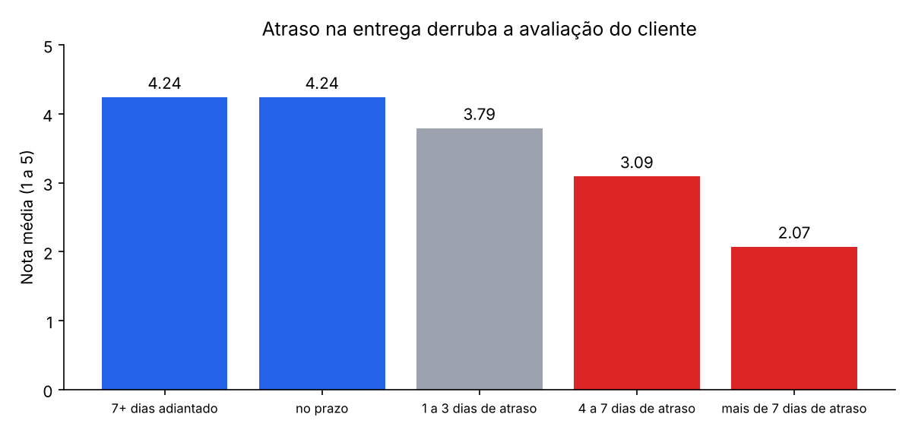
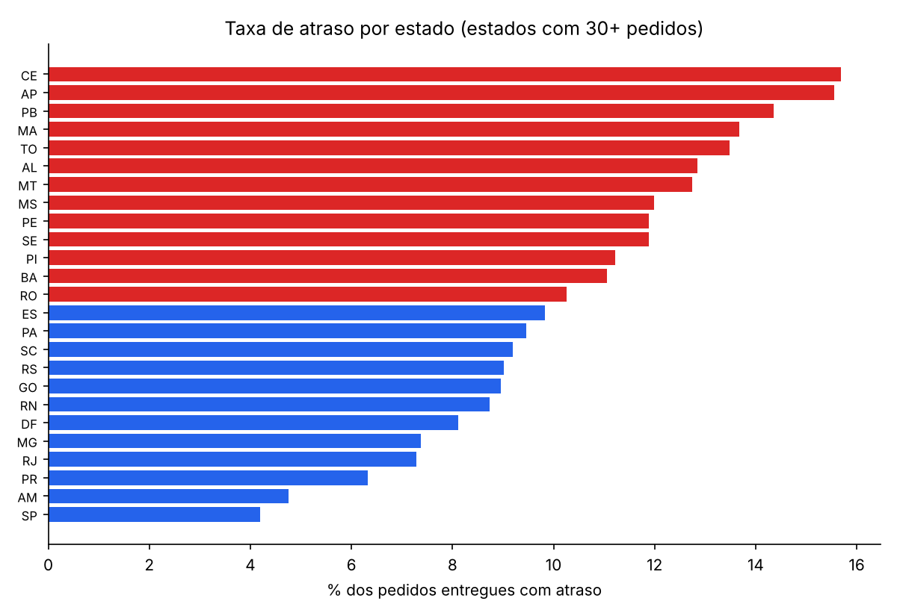
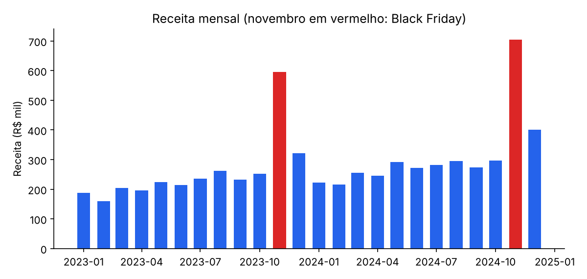

# Análise de E-commerce no Brasil: pipeline SQL + dashboard

[](https://github.com/juliamunizcarvalh0/analise-ecommerce-brasil/actions/workflows/ci.yml)


**[▶ Abrir o dashboard ao vivo](https://duckdb-ecommerce-dashboard.streamlit.app/)**: sem instalar nada.

Pipeline de dados de ponta a ponta para um e-commerce brasileiro: carrega os dados brutos, transforma tudo com **SQL em camadas** (staging → marts) no DuckDB, valida a qualidade dos dados e entrega um **dashboard interativo** com vendas, logística, satisfação e comportamento de clientes.

Os dados seguem exatamente o formato do [dataset público da Olist](https://www.kaggle.com/datasets/olistbr/brazilian-ecommerce) (~100 mil pedidos reais). O repositório gera uma versão sintética de 40 mil pedidos para rodar sem download, e **funciona com os dados reais** sem mudar uma linha: basta colocar os CSVs da Olist em `data/raw/`.

## Principais descobertas

**1. Atraso na entrega é o que mais destrói a satisfação.** Pedidos entregues no prazo têm nota média 4,24. Com mais de 7 dias de atraso, a nota cai para 2,07, e a fatia de notas 1 ou 2 sobe de 1,9% para **68%**.



**2. Norte e Nordeste sofrem com a logística.** Esses estados têm o dobro da taxa de atraso do Sul/Sudeste (12,0% contra 6,0%), e o frete chega a 21% do valor do pedido, contra 11% em SP.



**3. A Black Friday sobrecarrega a operação.** Novembro fatura 2,7× um mês comum, mas em novembro e dezembro a taxa de atraso sobe de 3,7% para **14,3%**, justo quando entram mais clientes novos.



**4. Quase ninguém volta a comprar.** Só 12,6% dos clientes compraram mais de uma vez, e a recompra mensal por coorte fica perto de 1%. Ainda assim, esses clientes respondem por 23% da receita.

### Recomendações

- Reforçar a logística e ampliar o prazo prometido **antes** da Black Friday, em especial para o Norte e Nordeste.
- Criar um alerta para pedidos com risco de atraso e avisar o cliente proativamente (ou oferecer um cupom), já que o atraso é o principal detrator da nota.
- Investir em recompra: campanhas para os segmentos RFM `novos_alto_valor` e `alto_valor_dormente`.

## Arquitetura

```
data/raw/*.csv  ──►  DuckDB
                      ├── raw_*        cópia fiel dos CSVs
                      ├── stg_*        limpeza, tipos e deduplicação   (sql/staging)
                      └── fct_ / mart_ tabelas analíticas              (sql/marts)
                              │
                              ├──► 9 testes de qualidade de dados
                              ├──► gráficos do relatório (reports/)
                              └──► dashboard Streamlit (app.py)
```

| Tabela | O que responde |
|---|---|
| `fct_pedidos` | Um pedido por linha: valor, frete, categoria, pagamento, nota, atraso |
| `mart_receita_mensal` | Receita, ticket médio e crescimento mês a mês e ano a ano (funções de janela) |
| `mart_entregas_estado` | Prazo médio, percentil 90, taxa de atraso e peso do frete por estado |
| `mart_atraso_vs_nota` | Relação entre atraso e satisfação |
| `mart_categorias` | Receita e participação por categoria |
| `mart_rfm` | Segmentação de clientes por Recência, Frequência e Valor |
| `mart_coortes` | Retenção de clientes por mês da primeira compra |

### Decisões técnicas

- **SQL versionado em arquivos**, executados em ordem e em camadas, no estilo do dbt, mas sem dependências extras.
- **Tratamento de armadilhas reais do dataset Olist:** pedidos com mais de uma avaliação (fica a mais recente), pedidos pagos com mais de um meio (cartão + voucher) e a diferença entre `customer_id` (por pedido) e `customer_unique_id` (por pessoa), que é essencial para medir recompra.
- **Testes de qualidade de dados** rodam a cada execução e interrompem o pipeline se algo quebrar (chaves duplicadas, notas fora de 1 a 5, pagamento que não fecha com itens + frete, receita do mart diferente da tabela fato…).
- **Testes unitários das regras de negócio** com tabelas minúsculas montadas à mão, onde o resultado certo é conhecido.

## Como rodar

```bash
git clone https://github.com/juliamunizcarvalh0/analise-ecommerce-brasil.git
cd analise-ecommerce-brasil
python -m venv .venv && source .venv/bin/activate
make install
make all          # gera os dados, roda o pipeline e os gráficos
make dashboard    # abre o dashboard em http://localhost:8501
make test
```

Para usar os **dados reais da Olist**, baixe-os no Kaggle, copie os CSVs para `data/raw/` e rode `make pipeline report`.

O dashboard está publicado no [Streamlit Community Cloud](https://duckdb-ecommerce-dashboard.streamlit.app/) e constrói o banco sozinho na primeira execução.

## Estrutura

```
├── sql/
│   ├── staging/        # 4 modelos de limpeza
│   └── marts/          # 7 modelos analíticos
├── src/ecommerce/
│   ├── generate.py     # dados sintéticos no formato Olist
│   ├── pipeline.py     # carga, execução do SQL e testes de qualidade
│   └── report.py       # gráficos do relatório
├── app.py              # dashboard Streamlit
├── tests/              # pytest: regras de negócio e pipeline completo
└── reports/figures/
```

## Tecnologias

SQL · DuckDB · Python · pandas · Streamlit · Plotly · Matplotlib · pytest · GitHub Actions

## Licença

MIT
